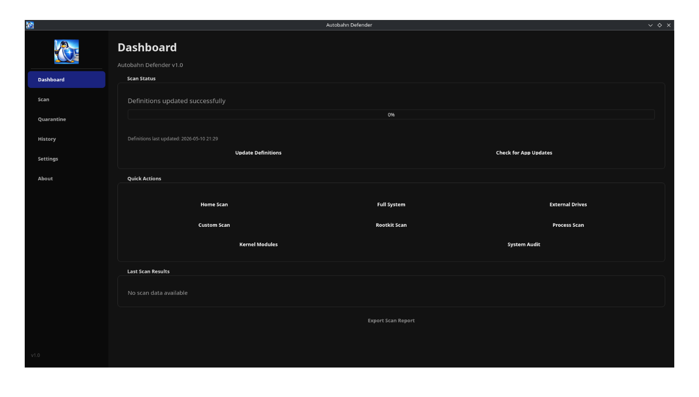
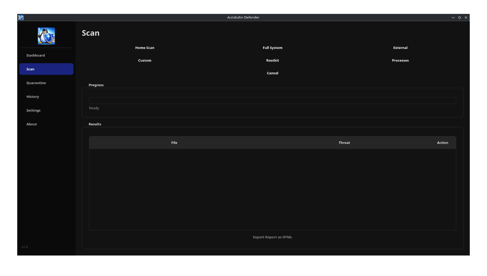
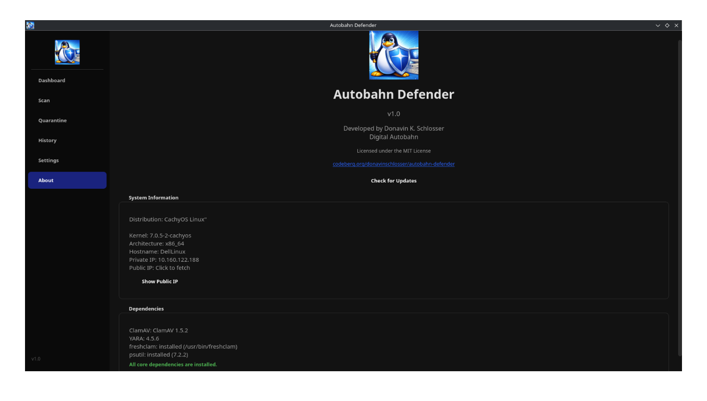

<div align="center">
  
  <h1>Autobahn Defender</h1>
  <p>A modern Linux antivirus application using ClamAV and YARA engines, built with PyQt6.</p>
</div>

## Screenshots

| Dashboard | Scan | About |
|-----------|------|-------|
|  |  |  |

## Features

### Scanning Engines
- **ClamAV Integration** — Full ClamAV scanning with custom or system definitions
- **YARA Rules** — Custom YARA rule support with downloadable rule sets
- **Process Scanning** — Detect suspicious processes, crypto-miners, and high-CPU anomalies

### Scan Types
- **Home Scan** — Scans Downloads, Documents, and Desktop directories
- **Full System Scan** — Complete filesystem scan (best with root privileges)
- **External Drives Scan** — Scans mounted USB and external media
- **Custom Scan** — Choose a specific directory to scan
- **Rootkit Scan** — Scans `/usr/bin`, `/usr/sbin`, and `/usr/lib` for rootkits
- **Process Scan** — Analyzes running processes for suspicious activity

### Scan Options (Configurable in Settings)
- **Archive Scanning** — Scan inside compressed files (zip, tar, rar, 7z, etc.). On by default, can be toggled off for speed.
- **Hidden File Scanning** — Scan hidden files and directories (dotfiles). On by default.
- **Parallel Scan Threads** — Configure how many paths YARA scans simultaneously. Defaults to 25% of CPU cores (minimum 1).

### Real-Time Protection
- **USB Monitoring** — Auto-scan newly connected USB/removable drives
- **File Watching** — Monitor up to 3 custom directories for real-time scanning
- **Scheduled Scans** — Set up recurring scans at configurable intervals (12h, daily, 5/15/30 days)

### Quarantine Management
- Move infected files to a secure quarantine directory
- Restore or permanently delete quarantined files
- SHA256 hash verification for quarantined files
- Secure file deletion with overwrite

### System Security Tools
- **Kernel Module Checker** — Detect suspicious, unsigned, or unknown kernel modules
- **System Audit (Hardening)** — Check firewall, SSH config, file permissions, and more
- **Firewall Management** — View and apply UFW/firewalld rules

### Definition Updates
- Download and update ClamAV virus definitions directly from within the app
- One-click definition updates from the Settings tab or Dashboard

### Application Updates
- Check for new versions from Codeberg releases
- Download and install updates (AppImage, deb, or Arch package)

### History & Reporting
- Scan history with timestamps, file counts, and threat counts
- Quarantine history log
- Audit history for hardening checks
- Export scan reports to HTML

## Installation

### AppImage (Recommended for all distributions)

The AppImage is fully self-contained — no Python, PyQt6, or other dependencies needed.

1. Download `Autobahn_Defender-x86_64.AppImage` from the [latest release](https://codeberg.org/donavinschlosser/Autobahn-Defender/releases)
2. Make it executable:
   ```bash
   chmod +x Autobahn_Defender-x86_64.AppImage
   ```
3. Run it:
   ```bash
   ./Autobahn_Defender-x86_64.AppImage
   ```

**Installing with Gear Lever (recommended):**

Gear Lever is a graphical AppImage manager that creates desktop entries and keeps AppImages organized.

1. Install Gear Lever from your distribution's package manager or [Flathub](https://flathub.org/apps/io.github.fabrialberio.gearlever)
2. Open Gear Lever
3. Drag and drop the `Autobahn_Defender-x86_64.AppImage` file into Gear Lever
4. Gear Lever will integrate it into your application menu automatically

### Debian/Ubuntu (.deb package)

1. Download `autobahn-defender_1.0_amd64.deb` from the [latest release](https://codeberg.org/donavinschlosser/Autobahn-Defender/releases)
2. Install it:
   ```bash
   sudo dpkg -i autobahn-defender_1.0_amd64.deb
   sudo apt-get install -f  # Fix any missing dependencies
   ```
3. Launch from your application menu or run `autobahn-defender`

### Arch Linux (.pkg.tar.zst package)

1. Download `autobahn-defender-1.0-1-x86_64.pkg.tar.zst` from the [latest release](https://codeberg.org/donavinschlosser/Autobahn-Defender/releases)
2. Install it:
   ```bash
   sudo pacman -U autobahn-defender-1.0-1-x86_64.pkg.tar.zst
   ```
3. Launch from your application menu or run `autobahn-defender`

### From Source

**Prerequisites:**
- Python 3.10+
- PyQt6
- ClamAV (optional, for virus scanning)
- YARA (optional, for pattern matching)
- psutil (optional, for process scanning)

**Steps:**
```bash
git clone https://codeberg.org/donavinschlosser/Autobahn-Defender.git
cd Autobahn-Defender
pip install -r requirements.txt
python main.py
```

**Building a standalone binary (PyInstaller):**
```bash
pip install pyinstaller
pyinstaller AutobahnDefender.spec --noconfirm
```
The binary will be at `dist/autobahn-defender`.

**Building an AppImage:**
```bash
pip install pyinstaller
bash build_appimage.sh
# Then run appimagetool on the resulting AppDir
```

## Dependencies for Scanning

Autobahn Defender works without scanning engines installed, but for actual virus detection you need at least one:

| Engine | Install | Used For |
|--------|---------|----------|
| ClamAV | `sudo apt install clamav` or `sudo pacman -S clamav` | Virus scanning with signature database |
| YARA | `sudo apt install yara` or `sudo pacman -S yara` | Pattern matching and custom rule scanning |
| psutil | `pip install psutil` | Process scanning (crypto-miner detection) |

## Configuration

Settings are stored using Qt's QSettings and persist across sessions:

- **Real-Time Monitoring** — File watching and USB auto-scan
- **Scheduled Scans** — Frequency, time, and scan type
- **YARA Rules** — Custom rule editor with download capability
- **Virus Definitions** — Update ClamAV definitions from within the app
- **Scan Options** — Archive scanning, hidden file scanning, thread count
- **Whitelist** — Exclude paths from all scans
- **Firewall** — View and apply firewall rules

## Project Structure

```
main.py              — Application entry point, main window, and tray icon
ui_tabs.py           — All UI tab widgets (Dashboard, Scan, Quarantine, etc.)
scanner.py           — Core scanning engine (ClamAV + YARA + process scanning)
settings.py          — Persistent settings manager
quarantine.py        — Quarantine file management with secure deletion
updater.py           — Application update checker and installer
history_db.py        — SQLite database for scan/quarantine/audit history
kernel_checker.py    — Kernel module security checker
firewall.py          — Firewall detection and rule management
hardening.py         — System hardening audit checks
usb_monitor.py       — USB device detection and auto-scanning
```

## License

MIT License — See [LICENSE](LICENSE) for details.