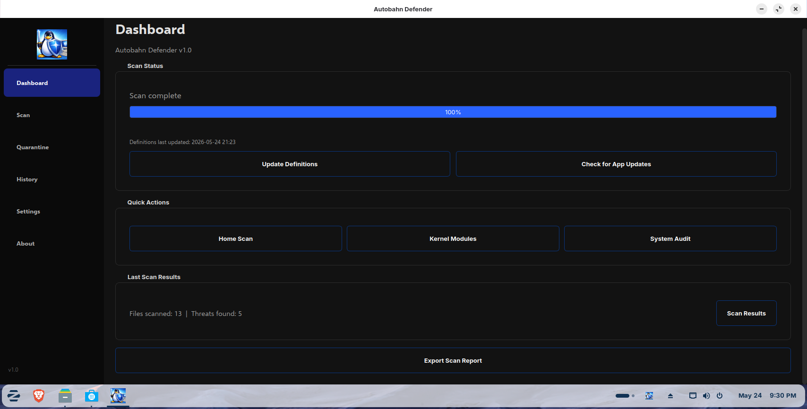
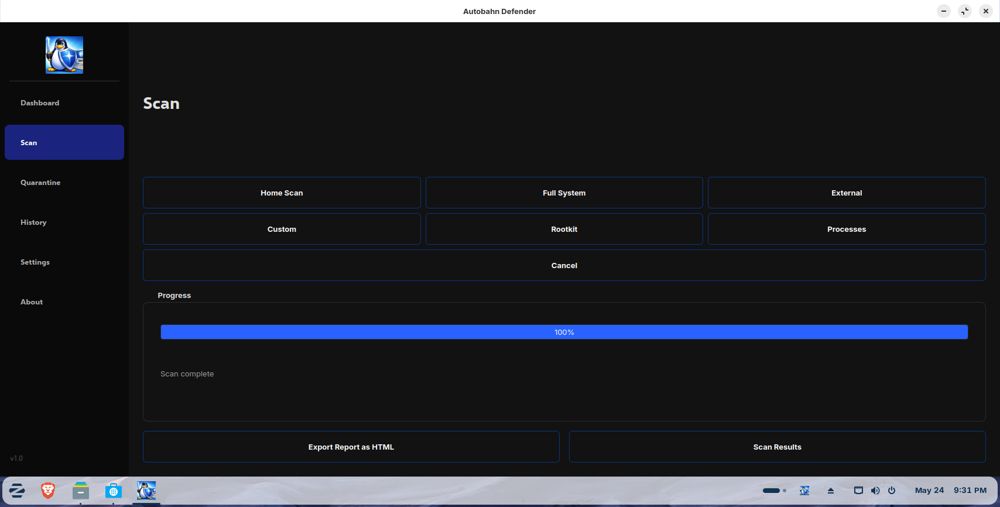
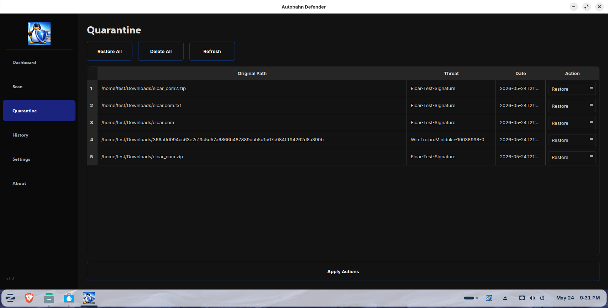
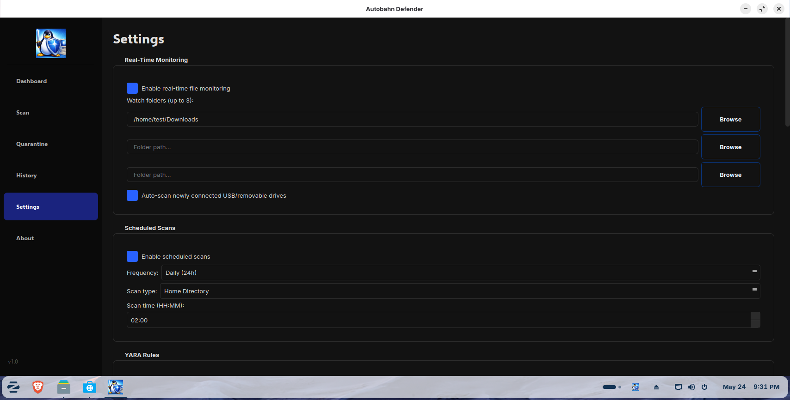
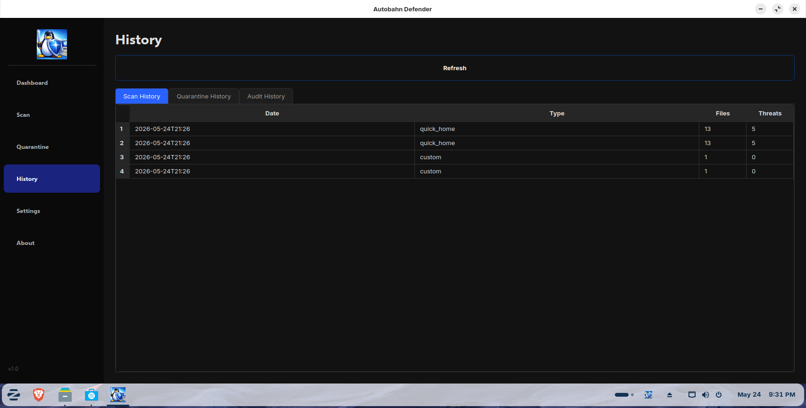
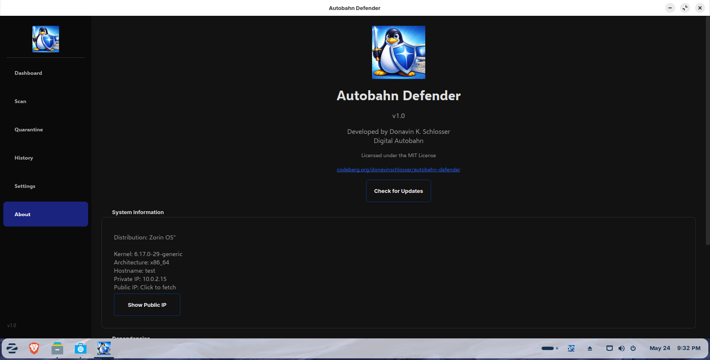
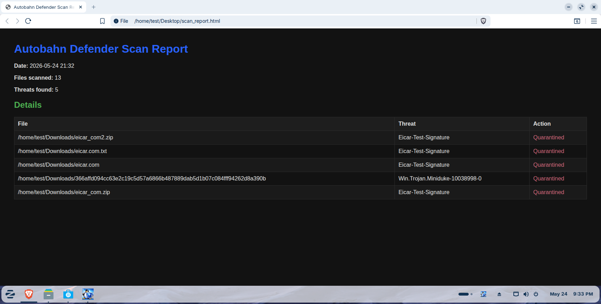

<div align="center">


# Autobahn Defender v2.0

A modern Linux antivirus application using ClamAV, YARA, and a local AI security
analysis engine (Qwen3-4B-Instruct via Ollama sidecar), built with PyQt6.

</div>

## v2.0 AI Security Update

Autobahn Defender v2.0 adds a dedicated **AI Security** tab with local,
offline AI-powered security analysis. The AI runs 100% on your CPU using
Qwen3-4B-Instruct (Q4_K_M GGUF, ~2.5 GB) via a managed Ollama sidecar
process. No GPU required. No internet required for core functionality.

Key design principles:
- **Button-driven, not chat-driven** -- the user does not type messages.
  Buttons trigger specific security analysis workflows.
- **AI thinking is visible** -- streaming output panel shows the reasoning
  and tool calls in real-time.
- **All tool calls are whitelisted Python functions** -- the model NEVER
  gets raw shell access.
- **Everything bundled** -- no extra downloads for the user (model GGUF
  and Ollama binary ship in the .deb).
- **NO USER CONFIGURATION** -- the model, context size, temperature, and
  all AI parameters are fixed and hardcoded. The only control is an
  ON/OFF toggle for the entire AI system.
- **NO PAID SERVICES** -- only free, open-source tools and APIs:
  DuckDuckGo (free, no key), OSV.dev (free, no key), and 8 hardcoded
  Linux security RSS feeds.

### AI Security Features
- Full Security Audit (firewall, AppArmor, processes, ports, updates,
  SUID, SSH, kernel, auth logs)
- Firewall Analysis, AppArmor/SELinux Status, Running Process Analysis
- Installed App Audit with CVE matching (OSV.dev)
- Network Scan, SSH Hardening Check
- Security News Monitor (8 RSS feeds, polled every 6 hours)
- CVE Matching, Zero-Day Watch, Threat Intel Summary
- Investigate File (YARA + hash + DuckDuckGo lookup)
- Investigate IP/Domain (WHOIS + DuckDuckGo)
- Investigate Process (PID + binary hash + connections)
- HTML Report Generation with security score
- JSONL intelligence database (auto-managed by the AI)

## Screenshots

| Dashboard | Scan | Quarantine | Settings |
|-----------|------|------------|----------|
|  |  |  |  |

| History | About | System Tray (Zorin OS) | Scan Report |
|---------|-------|------------------------|-------------|
|  |  |  |  |

## Features

### Scanning Engines
- **ClamAV Integration** — Full ClamAV scanning with custom or system definitions
- **Parallel ClamAV Scanning** — Multiple clamscan processes run simultaneously on separate CPU cores, roughly doubling scan speed on multi-core systems. Enabled by default. Uses clamscan's `-f` file-list option to handle any number of files without OS argument limits.
- **YARA Rules** — Ships with 1,958 curated Linux-focused YARA rules (Elastic Security, Florian Roth signature-base, ReversingLabs) out of the box. Optional Windows malware rules (69 rules) and macOS malware rules (31 rules) can be enabled in Settings. YARA rules auto-update from the Codeberg repo independently of app releases.
- **Process Scanning** — Detect suspicious processes, crypto-miners, and high-CPU anomalies

### Scan Types
- **Home Scan** — Scans Downloads, Documents, and Desktop directories
- **Full System Scan** — Complete filesystem scan (best with root privileges)
- **External Drives Scan** — Scans mounted USB and external media
- **Custom Scan** — Choose a specific directory to scan
- **Rootkit Scan** — Scans `/usr/bin`, `/usr/sbin`, and `/usr/lib` for rootkits
- **Process Scan** — Analyzes running processes for suspicious activity

### Scan Options (Configurable in Settings)
- **Archive Scanning** — Scan inside compressed files (zip, tar, rar, 7z, etc.). On by default, can be toggled off for speed.
- **Hidden File Scanning** — Scan hidden files and directories (dotfiles). On by default.
- **Parallel Scan Threads** — Automatically set to half of CPU threads (e.g., 8 threads on a 16-thread CPU). Controls both YARA ThreadPoolExecutor workers and the number of parallel clamscan processes.
- **Parallel ClamAV Toggle** — Enable/disable parallel ClamAV scanning (multiple clamscan processes on separate cores). Enabled by default.
- **Scan Engine Selection** — Choose Both (ClamAV + YARA), ClamAV only, or YARA only.

### Real-Time Protection
- **USB Monitoring** — Auto-scan newly connected USB/removable drives
- **File Watching** — Monitor up to 3 custom directories for real-time scanning
- **Scheduled Scans** — Set up recurring scans at configurable intervals (12h, daily, 5/15/30 days)

### Quarantine Management
- Move infected files to a secure quarantine directory
- Restore or permanently delete quarantined files
- SHA256 hash verification for quarantined files
- 3-pass secure file deletion with overwrite

### System Security Tools
- **Kernel Module Checker** — Detect suspicious, unsigned, or unknown kernel modules
- **System Audit (Hardening)** — Check firewall, SSH config, file permissions, and more
- **Firewall Management** — View and apply UFW/firewalld rules

### Definition Updates
- Download and update ClamAV virus definitions directly from within the app
- One-click definition updates from the Settings tab or Dashboard
- Automatic 24-hour periodic definition check on launch and in background
- Downloads all three definition databases (main.cvd, daily.cvd, bytecode.cvd) with HTTP fallback

### Application Updates
- Check for new versions from Codeberg releases
- Download and install updates (AppImage, deb, or Arch package)

### History & Reporting
- Scan history with timestamps, file counts, and threat counts
- Quarantine history log
- Audit history for hardening checks
- Export scan reports to HTML

## Installation

### AppImage (Recommended for all distributions)

The AppImage is fully self-contained — no Python, PyQt6, or other dependencies needed. Built with glibc 2.35 compatibility for broad Linux support (Linux Mint 20+, Ubuntu 20.04+, etc.).

1. Download `AutobahnDefender.AppImage` from the [latest release](https://codeberg.org/donavinschlosser/Autobahn-Defender/releases)
2. Make it executable:
   ```bash
   chmod +x AutobahnDefender.AppImage
   ```
3. Run it:
   ```bash
   ./AutobahnDefender.AppImage
   ```

**Installing with Gear Lever (recommended):**

Gear Lever is a graphical AppImage manager that creates desktop entries and keeps AppImages organized.

1. Install Gear Lever from your distribution's package manager or [Flathub](https://flathub.org/en/apps/it.mijorus.gearlever)
2. Open Gear Lever
3. Drag and drop the `AutobahnDefender.AppImage` file into Gear Lever
4. Gear Lever will integrate it into your application menu automatically

On first run, the app will also automatically install a `.desktop` file to `~/.local/share/applications/` for proper window grouping, icon resolution, and Wayland portal support.

### Debian/Ubuntu (.deb package)

1. Download `autobahn-defender_1.4_amd64.deb` from the [latest release](https://codeberg.org/donavinschlosser/Autobahn-Defender/releases)
2. Install it:
   ```bash
   sudo dpkg -i autobahn-defender_1.4_amd64.deb
   sudo apt-get install -f  # Fix any missing dependencies
   ```
3. Launch from your application menu or run `autobahn-defender`
4. On first launch, the app will prompt to install ClamAV and YARA if missing. You can also install them manually:
   ```bash
   sudo apt install clamav clamav-freshclam yara python3-psutil
   ```

The .deb package also:
- Runs freshclam during installation to pre-download virus definitions
- Disables the system `clamav-freshclam` service (the app manages its own definition updates internally)

### Arch Linux (.pkg.tar.zst package)

1. Download `autobahn-defender-1.3-5-x86_64.pkg.tar.zst` from the [latest release](https://codeberg.org/donavinschlosser/Autobahn-Defender/releases)
2. Install it with the included script (recommended — handles dependencies):
   ```bash
   bash install_arch.sh
   ```
   Or manually:
   ```bash
   sudo pacman -U autobahn-defender-1.3-5-x86_64.pkg.tar.zst
   ```
3. Launch from your application menu or run `autobahn-defender`
4. Scanning engines are installed automatically by the script. If installing manually:
   ```bash
   sudo pacman -S clamav yara python-psutil
   ```

> **Tip:** If you have the repo cloned locally, just double-click `install_arch.sh` in your file manager — it handles everything (distro check, dependencies, sudo elevation, and package installation).

### From Source

**Prerequisites:**
- Python 3.10+
- PyQt6
- ClamAV (optional, for virus scanning)
- YARA (optional, for pattern matching)
- psutil (optional, for process scanning)

**Steps:**
```bash
git clone https://codeberg.org/donavinschlosser/Autobahn-Defender.git
cd Autobahn-Defender
pip install -r requirements.txt
python main.py
```

**Building a standalone binary (PyInstaller):**
```bash
pip install pyinstaller
pyinstaller AutobahnDefender.spec --noconfirm
```
The binary will be at `dist/autobahn-defender`.

**Building an AppImage (Docker-based for glibc compatibility):**
```bash
bash build_appimage.sh
```
This builds inside Docker with Ubuntu 22.04 (glibc 2.35) for maximum compatibility.
The resulting `AutobahnDefender.AppImage` will work on Linux Mint 20+, Ubuntu 20.04+, and other older distributions.

**Building a DEB package:**
```bash
bash build_deb.sh
```
This extracts an existing AppImage and packages it into a `.deb`. Requires `AutobahnDefender.AppImage` to exist first.

## Dependencies for Scanning

Autobahn Defender works without scanning engines installed, but for actual virus detection you need at least one:

| Engine | Install | Used For |
|--------|---------|----------|
| ClamAV | `sudo apt install clamav` or `sudo pacman -S clamav` | Virus scanning with signature database |
| YARA | `sudo apt install yara` or `sudo pacman -S yara` | Pattern matching and YARA Forge rule scanning |
| psutil | `pip install psutil` | Process scanning (crypto-miner detection) |

The app will detect missing dependencies on launch and offer to install them for you.

## YARA Rules

Autobahn Defender v1.4 ships with a **3-tier YARA rule system** — rules are split into platform-specific files for targeted scanning with minimal false positives:

| **Platform** | **File** | **Rules** | **Default** |
|-------------|---------|-----------|-----------|
| **Linux** | `linux-rules.yar` | 1,981 | ON |
| **Windows** | `windows-rules.yar` | 69 | OFF (opt-in) |
| **macOS** | `macos-rules.yar` | 31 | OFF (opt-in) |

The Linux rules combine Elastic Security Linux rules, Florian Roth's signature-base, and ReversingLabs zero-FP rules. Windows rules only apply to PE files (detected by MZ magic bytes) and macOS rules only apply to Mach-O files — reducing false positives by only running platform-specific rules against the correct file types.

### YARA Rule Auto-Update

YARA rules update **independently of app releases**. The app checks the Codeberg repository every 24 hours for new rules. When new rules are available:

1. The app reads `yara/VERSION` from the [Codeberg repo](https://codeberg.org/donavinschlosser/autobahn-defender/src/branch/main/yara) to check if the version has changed
2. If the remote version is newer, all 4 rule files are downloaded to `~/.autobahn/rules/upstream_*.yar`
3. The compiled rule cache (`.yc`) is deleted so rules are recompiled on the next scan
4. The update happens silently in the background — no user interaction needed

This means new zero-day YARA rules can be pushed to the repo's `yara/` folder and users get them automatically without updating the app. To publish new rules, just update the `.yar` files in `yara/` and bump `yara/VERSION` to a new number.

Auto-update is enabled by default and can be toggled in Settings > YARA Rules. The last update time is displayed in Settings.

### Bundled Rules vs Auto-Update

The app ships with rule files in `rules/` (inside the .deb) or bundled in the AppImage. On first launch, these are copied to `~/.autobahn/rules/`. The auto-updater downloads updated versions as `upstream_*.yar` alongside the bundled files. The scanner recognizes both naming variants and automatically excludes the legacy combined rule file (`autobahn-defender-rules.yar`) when the 4-tier files are present to prevent duplicate identifier errors.

### Custom Rules

Custom rules can be added to `~/.autobahn/rules/` (any `.yar` file). They are automatically loaded and merged on the next scan. Custom rules can also be edited via the built-in YARA rule editor in Settings.

## Configuration

Settings are stored using Qt's QSettings and persist across sessions:

- **Real-Time Monitoring** — File watching and USB auto-scan
- **Scheduled Scans** — Frequency, time, and scan type
- **Scan Engine** — Choose Both (ClamAV + YARA), ClamAV only, or YARA only
- **YARA Rules** — Enable/disable Windows, macOS rules; auto-update toggle; custom rule editor
- **Parallel ClamAV** — Toggle parallel clamscan processes (on by default)
- **Parallel Scan Threads** — Auto-set to half of CPU threads (adjustable)
- **Virus Definitions** — Update ClamAV definitions from within the app
- **Scan Options** — Archive scanning, hidden file scanning, thread count
- **Whitelist** — Exclude paths from all scans
- **Firewall** — View and apply firewall rules

## Project Structure

```
main.py              — Application entry point, main window, and tray icon
ui_tabs.py           — All UI tab widgets (Dashboard, Scan, Quarantine, etc.)
scanner.py           — Core scanning engine (parallel ClamAV + YARA + process scanning)
settings.py          — Persistent settings manager (auto-detects CPU threads)
quarantine.py        — Quarantine file management with secure deletion
updater.py           — Application update checker and installer
yara_updater.py      — YARA rule auto-updater (checks Codeberg repo every 24h)
history_db.py        — SQLite database for scan/quarantine/audit history
kernel_checker.py    — Kernel module security checker
firewall.py          — Firewall detection and rule management
hardening.py         — System hardening audit checks
usb_monitor.py       — USB device detection and auto-scanning

AutobahnDefender.spec — PyInstaller build specification
build_appimage.sh     — Docker-based AppImage builder (glibc 2.35)
build_deb.sh          — DEB package builder
install_arch.sh       — One-click Arch Linux installer script (double-click to run)
build_arch/           — Arch Linux PKGBUILD and pre-built .pkg.tar.zst package

rules/                — Bundled YARA rules (copied to ~/.autobahn/rules/ on first run)
yara/                 — Upstream YARA rules for auto-update (VERSION file + 4 .yar files)
icons/                — Application icons
Screenshots/          — Screenshots for README
```

### Build Notes

**OpenSSL Compatibility:** The PyInstaller spec (`AutobahnDefender.spec`) excludes bundled `libcrypto*` and `libssl*` to avoid conflicts with the system ClamAV's OpenSSL version. The system's OpenSSL is used at runtime instead, ensuring compatibility across distributions.

**ClamAV Definition Updates:** Definitions are downloaded via freshclam in the user's home directory (`~/.autobahn/definitions/`). If freshclam exits with only partial downloads (e.g., only `daily.cvd`), the app falls back to direct HTTP download from ClamAV mirrors to ensure all three databases (`main.cvd`, `daily.cvd`, `bytecode.cvd`) are present.

## Changelog

### Version 1.4

**New Features**
- **Parallel ClamAV Scanning** — Multiple clamscan processes run simultaneously on separate CPU cores, each scanning its own chunk of files. Enabled by default. On a 16-thread CPU with the default 8 parallel processes, ClamAV scanning is roughly 8x faster than single-process. Uses clamscan's `-f` file-list option to pass file paths via temp files, avoiding the OS "Argument list too long" error on large directory trees (700K+ files). Each process loads its own copy of the signature database (~500MB RAM per process).
- **Sequential YARA-First Scanning** — YARA runs first (0-50% progress), then ClamAV runs second (50-100%). Both phases show real file-count-based progress, not time estimates. YARA displays "YARA: 50000/729853 files scanned" every 2000 files. ClamAV displays "ClamAV: 50000/729853 files scanned" with combined count from all parallel processes.
- **yara-python Integration** — YARA scanning now uses the yara-python library directly (thread-safe Rules.match() via ThreadPoolExecutor) instead of spawning yara CLI subprocesses. Compiled rule caching (.yc files) for fast startup on subsequent launches.
- **3-Tier YARA Rules** — Rules split into platform-specific files: Linux (1,981 rules), Windows (69 rules), and macOS (31 rules). Windows and macOS rules are opt-in. Legacy combined rule file is excluded to prevent duplicate identifier errors.
- **YARA Rule Auto-Update** — YARA rules check for updates from the Codeberg repository independently of app releases. New zero-day rules can be pushed to the repo and users get them automatically without updating the app. Enabled by default.
- **Scan Engine Selection** — Choose Both (ClamAV + YARA), ClamAV only, or YARA only in Settings.
- **Auto-Detected Thread Count** — Parallel scan threads automatically set to half of CPU threads (e.g., 8 on a 16-thread CPU, 4 on an 8-thread CPU, 1 on a 2-core CPU). Migration logic resets stale values from older versions.
- **File-Type Detection** — YARA scanning detects file types by magic bytes (PE/ELF/Mach-O/script). Windows rules only apply to PE files, macOS rules only to Mach-O files, reducing false positives.

**Architecture Changes**
- **Clamd Daemon Removed** — Removed all ClamdManager, clamd, and clamdscan code. The clamd daemon approach caused persistent issues: silent hangs on large scans (MaxFiles/MaxScanTime limits), watchdog timeout problems, socket permission errors, and zero stdout output during --multiscan mode. Reverted to direct clamscan subprocess which provides reliable per-file output and accurate progress tracking.
- **Animated Dots / ETA Timer Removed** — Removed the animated "Scanning....." dots display and the time-based ETA timer that were needed for parallel clamd mode (where progress couldn't be tracked). Now uses direct percentage-based progress from actual file counts.
- **Progress Simplification** — Progress bar now shows simple 0-100% based on actual files scanned. YARA phase covers 0-50%, ClamAV phase covers 50-100%. No time estimates, no indeterminate busy mode.

**Security Fixes**
- **Quarantine path traversal** — Sanitized quarantine_name in manifest to prevent `../` directory escapes.
- **pkexec binary path validation** — Validate binary paths against whitelist to prevent command injection.
- **Secure delete empty file fix** — Handle empty files correctly in _secure_delete (skip instead of error).
- **SQLite WAL/SHM permissions** — Set restrictive permissions on SQLite sidecar files.
- **Process scan cpu_percent** — Fixed psutil cpu_percent always returning 0.0 by using interval-based sampling.
- **Duplicate closeEvent fix** — Fixed duplicate closeEvent that prevented clamd from being stopped on app exit (now moot since clamd is removed).

**Bug Fixes**
- **ClamAV stderr warnings** — LibClamAV warnings (e.g., "database is older than 7 days") no longer treated as scan errors. Only real errors with non-zero exit codes are reported.
- **YARA rule naming mismatch** — Fixed YARA rule name sets to match all naming variants used in build packages and auto-updates.
- **ClamAV argument list too long** — Fixed "Argument list too long" error when scanning 700K+ files by using clamscan's `-f` file-list option with temp files instead of passing all paths on the command line.

### Version 1.3

**New Features**
- **Start Minimized:** New "Start minimized to system tray" checkbox in Settings > Auto-Start. When enabled, the app launches to the tray instead of showing its window. Supports both the QSetting and a `--minimized` CLI flag in the autostart .desktop file.
- **Windows Malware Detection:** New optional YARA rules file (`windows-malware-rules.yar`) with 14 curated rules targeting WannaCry, Locky, Cerber, Emotet, QBot, Agent Tesla, XMRig, process injection, PowerShell droppers, browser credential stealers, UPX packers, and bootkits. All rules use PE magic byte conditions to prevent false positives on non-PE files. Disabled by default — opt in via Settings > YARA Rules checkbox.
- **File-Type Pre-Filtering:** YARA scanning now detects file types by magic bytes (PE/ELF/script). Windows rules only apply to PE files, reducing false positives from rules applied to wrong file types.
- **Safe Default Whitelist:** On first run, the whitelist is pre-populated with package-manager-managed system directories (/usr/lib, /usr/share, /lib, etc.) that are extremely unlikely to contain malware. Does not overwrite existing whitelists.
- **Visual Dashboard:** Color-coded threat summary bar on the Dashboard — green (0 threats), orange (1-5), red (6+). Updates dynamically after each scan.
- **Color-Coded Scan Results:** Threat names in the results table are color-coded by severity — red (ransomware/rootkits), purple (cryptominers), light red (trojans), yellow (suspicious), orange (errors).
- **Smooth Tab Transitions:** Tab switching now uses a QPropertyAnimation fade transition (150ms) for a polished feel.

**Security Fixes**
- **Secure delete memory fix:** `_secure_delete` in quarantine.py now uses 64KB chunked writes for all three passes, preventing OOM on large quarantined files.
- **ClamAV parsing fix:** Fixed `_parse_clamscan_output` splitting on colons, which truncated filenames containing colons. Now uses rsplit for correct parsing.
- **YARA file size limit:** Added 250MB maximum file size for YARA scanning to prevent OOM on very large files.
- **Autostart permissions:** Fixed autostart .desktop file from 0o755 (executable) to 0o644 (read-only).
- **Error logging:** YARA scan errors are now logged in scan results instead of being silently swallowed.
- **TOCTOU race fix:** quarantine_file now uses os.rename with O_NOFOLLOW to prevent symlink-based race conditions.
- **Database connection safety:** History database functions now use context managers to prevent connection leaks on errors.

**Bug Fixes**
- Version header comment updated to match APP_VERSION.
- YARA rule compilation caching — merged rules are cached and only re-merged when source files change.
- Batch YARA scanning — files are now batched into groups to reduce subprocess overhead.

### Version 1.2

**New Features**
- **Process exemptions by name:** Ignore Forever on process scan results now saves the PROCESS NAME (not PID). Whitelisted processes are filtered before detection so they never reappear across reboots or PID changes. Added `process_name` exemption type with case-insensitive matching.
- **First-launch setup wizard:** On first run, the main window stays hidden until dependencies are installed and virus definitions are downloaded. A splash screen shows progress throughout.
- **First-run guidance dialog:** After first-time setup completes, a detailed guidance dialog explains false positives, right-click YARA rule exemptions, managing exemptions in Settings, scheduled scans, and real-time protection.
- **Broader file scanning:** YARA scanner now scans ALL regular files (text files, PDFs, documents, archives, configs) instead of restricting to ELF binaries and scripts. Only empty files and device files are skipped. Archives are also checked by ClamAV when Archive Scanning is enabled.
- **One-click Arch installer:** New `install_arch.sh` script in the repo. Double-click to run or `bash install_arch.sh` on Arch/Manjaro/EndeavourOS.
- **Settings Exemptions panel:** Exemptions/Ignore List in Settings tab with click-to-remove and Clear All. Displays path exemptions, YARA rule exemptions, and process name exemptions.

**Bug Fixes**
- **YARA duplicated identifier error:** Fixed `_merge_yara_rules` failing on rules using YARA keywords (`private`, `global`) or tags (`rule Name : Tag {`). Old regex only matched basic forms, missing all other valid YARA formats.
- **Scan results not showing:** Fixed the Scan Results button staying greyed out and the results dialog not opening after scans. Now always shows results even when no threats are found.
- **Duplicate YARA rule files:** Removed duplicate rule file from repo (two identical `.yar` files with every rule name duplicated). Fixed first-run copy to skip identical files by content hash.
- **YARA validation missing stderr:** yara(1) exits 0 even when it silently skips duplicate rules due to compile errors. Now checks stderr for error, duplicated, and warning messages regardless of exit code.
- **AppImage build stale files:** Fixed build script to clean stale `_internal` before copying new files, preventing old deleted files from persisting in the AppImage.
- **Smart update detection:** Updater now detects install method (deb, Arch, or AppImage) via `dpkg -l`, `pacman -Q`, and `APPIMAGE` env var. Downloads the matching package type instead of always grabbing the AppImage.
- **Auto-install updates:** Both .deb and Arch package updates now install automatically after download. Arch: `sudo pacman -U --noconfirm`. deb: `pkexec dpkg -i` or `sudo dpkg -i`. No extra confirmation dialogs.
- **QDialog import fix:** Fixed NameError crash in PyInstaller bundle when `FirstRunGuidanceDialog` tried to use `QDialog` (was imported locally instead of at module level).
- **Outdated message removed:** Removed "only ELF binaries and scripts are scanned" message from YARA results (no longer accurate).
- **Missing import fixed:** Added missing `import subprocess` to `updater.py`.
- **Whitelist cleanup:** Legacy garbage entries in `whitelist.json` auto-filtered on startup.
- **Whitelist persistence:** Ignore Forever now properly persists across scans with structured whitelist using realpath normalization.
- **Stale desktop entries:** App detects and rewrites stale AppImage FUSE mount paths in desktop files.

**Changed**
- YARA rules updated to curated 1,958-rule set combining Elastic Security Linux rules, Florian Roth signature-base, and ReversingLabs rules -- all 100% Linux-focused.
- Version bumped to 1.2.
- All package versions updated (AppImage, deb, Arch).
- Cleaned up stale build artifacts from git tracking.

## License

MIT License — See [LICENSE](LICENSE) for details.
