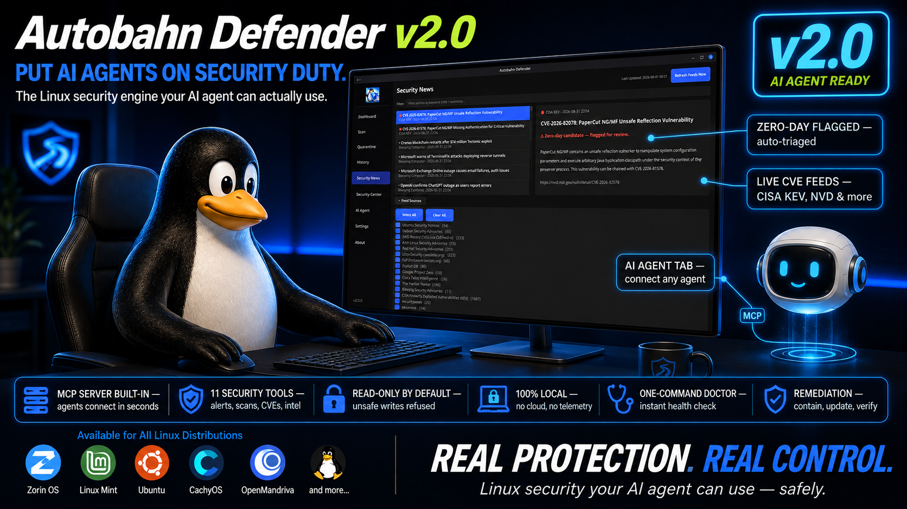
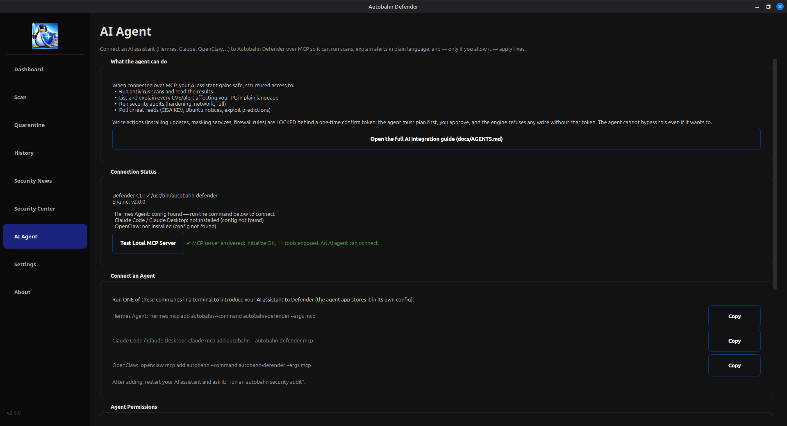
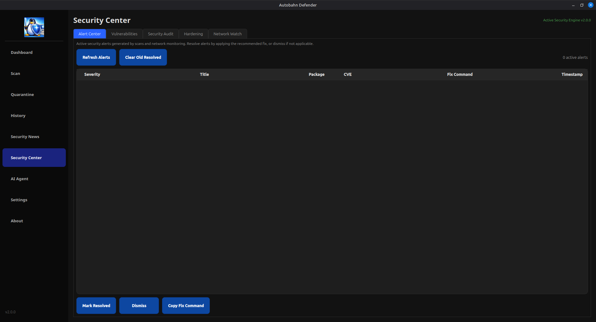
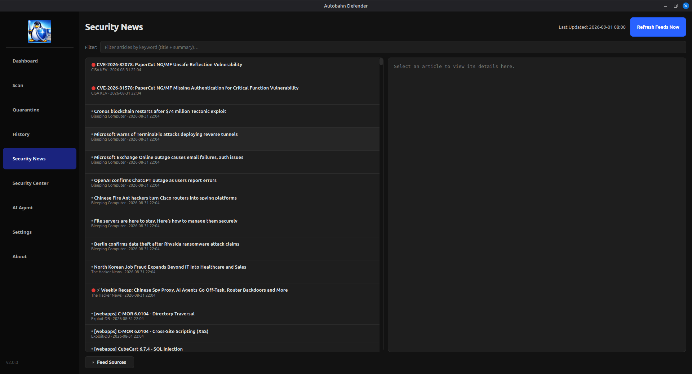

<p align="center">
  
</p>

# Autobahn Defender v2.0.3

**The Linux security engine your AI agent can actually use — safely.**

Autobahn Defender is a Linux antivirus and security suite with a deterministic
detection engine (ClamAV + YARA), a full headless CLI, a CVE/zero-day
intelligence monitor, and a built-in **MCP server** that lets AI agents
(Hermes, Claude, OpenClaw, …) run security work with guardrails. 100% local.
No cloud, no telemetry, no API keys.

---

## What's new in v2.0.3

### Parallel ClamAV scans now actually scan (silent-skip fix)

A user report (`UnboundLocalError` on `file_list_path`, `Exception in thread
Thread-N`) traced to two defects in the parallel ClamAV scanner, both fixed:

1. **The scan block sat outside the batch loop.** In `run_single_clamscan()`
   the try/except/finally that runs clamscan was a sibling of the `while`
   loop, not its child, while `file_list_path` was only ever bound inside the
   loop body. Worker threads that found the shared batch queue already empty
   (the common case — workers race to drain one queue) fell straight through
   to the orphaned cleanup and died with `UnboundLocalError: cannot access
   local variable 'file_list_path'` — the reported thread death.
2. **`clam_env` was never bound in that scope.** Workers that did reach the
   scan block crashed on `Popen(env=clam_env)` with `NameError: name
   'clam_env' is not defined`, so the batch never ran. Net effect on 2.0.2: a
   parallel ClamAV scan reported **0 files scanned**, with error rows instead
   of coverage — the worst failure mode for an antivirus.

Fixed by moving the scan block inside the loop (indentation only) and binding
`clam_env` once at function scope (mirroring the single-process runner).
YARA scanning was never affected — this was the ClamAV path only. New
regression tests pin both the structure (AST) and end-to-end behaviour (the
real runner is driven with a stub clamscan: every batch is scanned, no worker
thread dies, the startup status fires exactly once).

**Ran a parallel ClamAV scan on 2.0.2? Upgrade.** After upgrading, re-scan
and check the scanned-file count is close to the file count.

## What's new in v2.0.2

### 1. The AppImage is now fully self-contained

The v2.0.2 AppImage bundles the complete **ClamAV engine** inside the image —
no system installs, no package-manager prompts, ever. On first launch it
downloads virus definitions directly to your user folder (one-time ~300 MB,
no root required, no system service). The "install dependencies?" dialog that
broke the AppImage's promise is gone. File size went 56 MB → 76 MB; that's
the engine riding along.

### 2. Fixed the scan hang on eCryptfs-encrypted systems

A user report nailed this one: on eCryptfs homes, a full scan spawned one
process per core, some finished, and the rest idled at 0% CPU forever. Root
cause: clamscan writes one error line per unreadable file (every file in the
raw encrypted store), and the app read stderr only after the process exited —
the ~64KB pipe buffer filled, the process blocked mid-write, and the whole
scan wedged. Fixed four ways:

- stderr is captured to a file (unbounded) in every runner — the deadlock is
  structurally impossible
- raw eCryptfs stores are skipped by both engines (ciphertext can't match
  signatures; the decrypted files are already scanned)
- unreadable files aggregate into ONE honest row instead of a truncated path
- a stall watchdog kills and reports any silent process after 900 s — worst
  case is a completed scan with a reported error, never an eternal spinner

Scan work is now distributed via queue-based batching, so all scan processes
stay busy until the end instead of some idling while others grind.

### 3. From v2.0.1 (recap)

- AppImage bundled the missing AI Agent / Security Center / News tabs
  (with a bundle verifier that fails the build if anything is missing) and
  yara-python (fixes the Rootkit scan force-close)
- `autobahn.scan` — the 12th MCP tool: your AI agent scans any file, folder,
  directory tree, or drive as a detached job with a live feed and a blocking
  wait-for-completion call

---

## What's new in v2.0

This is a ground-up rebuild of the security engine. The highlights:

### 1. The engine runs headless — everything is drivable

Every feature that used to require clicking through the GUI now works from a
terminal. This matters for servers, SSH boxes, and automation:

```bash
autobahn-defender scan /home            # antivirus scan (YARA + ClamAV)
autobahn-defender cve                   # scan installed packages against OSV.dev
autobahn-defender audit full            # full system audit, scored findings
autobahn-defender audit hardening       # hardening-focused audit
autobahn-defender intel poll            # refresh threat feeds
autobahn-defender intel check           # match feeds against your machine
autobahn-defender alerts list           # what's active right now
autobahn-defender doctor                # environment self-check (21 checks)
autobahn-defender mcp                   # run the AI-agent MCP server
```

Exit codes are machine-readable (`0` clean / `1` findings / `2` error) and
every verb takes `--format json|table|markdown|html`, so scripts and agents
always get parseable output.

### 2. MCP server for AI agents

`autobahn-defender mcp` speaks the Model Context Protocol over stdio. Any MCP
host — Hermes, Claude Code, Claude Desktop, OpenClaw — gets **12 tools**:

| Tool | What it does |
|------|-------------|
| `autobahn.doctor` | environment/deps self-check |
| `autobahn.checks.list` | list deterministic security checks |
| `autobahn.checks.run` | run one check by name |
| `autobahn.cve.scan` | scan installed packages against OSV.dev (cache-first) |
| `autobahn.audit` | run an audit profile (full/vuln/network/hardening) |
| `autobahn.scan` | **NEW** — scan a file/folder/drive as a detached job: start → live status/tail feed → wait (completion result) or cancel |
| `autobahn.intel.poll` | poll CISA KEV + Ubuntu USN + EPSS + PoC feeds |
| `autobahn.intel.check` | match feeds against installed packages |
| `autobahn.intel.list` | list recent intel alerts |
| `autobahn.alerts` | list active engine alerts |
| `autobahn.remediate.plan` | plan containment/update/verify/restore → issues a one-time token |
| `autobahn.remediate.execute` | execute the plan **only with that token** |

**Read-before-write is not negotiable:** an agent can read anything, but every
write (updates, containment, firewall) needs a fresh one-time token from a
prior `plan` call. The GUI's **AI Agent tab** enforces your policy on every
call — set it to *Off* and the server refuses to start at all.

### 3. CVE & zero-day intelligence (free, no API keys)

- **CISA KEV** — the US government list of actively-exploited CVEs
- **Ubuntu security notices (USN)** — per-release fix versions
- **EPSS** — exploit probability scores (366k+ CVEs)
- **PoC-in-GitHub** — public proof-of-concept exploit tracker

Feeds are matched against what's actually installed. Alerts carry severity,
exploited-in-the-wild flags, and honest patch info — including the
distinction between *fix is in the normal archive* and *fix requires Ubuntu
Pro/ESM*. Fixed things stop alerting: alerts auto-resolve on the next check
when a CVE no longer matches your installed packages.

### 4. Remediation lifecycle

Alert → **contain** (mask service) → **update** (distro packages) →
**verify** (re-check whether the CVE actually matches anymore) → **restore**.
Verify is honest: if the feed is unreachable it reports `inconclusive`,
never a false "fixed".

### 5. Rebuilt YARA rule set (zero false positives on system files)

The bundled Linux rules were rebuilt to require **malware-specific
indicators** (family names, mining-pool URLs, IoC paths) instead of generic
keywords. Result on a stock system directory:

- Before: ~9,400 hits on `/usr/bin` alone
- After: **0**

And a hard guarantees layer in the scanner: files owned by distro packages
(`/usr`, `/lib`, …) are **never auto-quarantined** on a YARA match — they're
flagged for review. User files keep full quarantine behavior.

### 6. Everything else

- CVSS 3.1 scoring with correct Debian/Ubuntu version comparison
- Honest "inconclusive ≠ fixed" patch verification
- Active-watch daemon (inotify): downloads, autostart, cron, ssh config
- Quarantine with SHA256 ledger and restore
- One-command `doctor` health check (21 checks)
- AI Agent tab in the GUI: connect any agent in seconds, permission matrix
- 123-test suite, clean-Ubuntu-24.04-container verified

See [docs/CHANGELOG-v2.0.md](docs/CHANGELOG-v2.0.md) for the full technical
changelog.

---

## Installing

### Debian / Ubuntu / Linux Mint (deb)

Grab the `.deb` from the [releases page](https://codeberg.org/donavinschlosser/Autobahn-Defender/releases):

```bash
sudo dpkg -i autobahn-defender_2.0.3_amd64.deb
# if any dependency is missing:
sudo apt-get install -f
```

Upgrades from 1.x or any interim build are drop-in: your
`~/.autobahn` data (history, quarantine, rules, definitions) is preserved.
The in-app updater handles the download and install for you on future
versions.

After installing, launch **Autobahn Defender** from your menu, or:

```bash
autobahn-defender scan ~/     # CLI works immediately
```

### AppImage (any distro)

```bash
chmod +x AutobahnDefender.AppImage
./AutobahnDefender.AppImage
```

The AppImage is self-contained (built on Ubuntu 22.04 base for old-glibc
compatibility). **As of v2.0.2 it bundles the full ClamAV engine** — no
system installs, no package-manager prompts. On first launch it downloads
virus definitions to your user folder (~300 MB, one-time, no root). YARA
scanning works out of the box via the bundled yara-python.

### Arch / Arch-based

A `PKGBUILD` is provided in `build_arch/`. From a clone of this repo:

```bash
cd build_arch
cp ../build_arch/PKGBUILD.v2 PKGBUILD   # if building from a repo checkout
makepkg -si
```

Or with yay from a release tarball (contains the same tree):

```bash
yay -S --noconfirm ./autobahn-defender-2.0.3-1-any.pkg.tar.zst
```

---

## Building from source

Works on any distro with Python 3.10+ (Arch, Fedora, openSUSE, …). The app
runs directly from source with your system Python — no PyInstaller needed
(the bundled PyInstaller path in `autobahn-defender.spec`/`build_appimage.sh`
is optional for packagers).

```bash
# 1. System dependencies
sudo apt install python3 python3-pyqt6 python3-psutil python3-yara \
                 python3-requests python3-feedparser python3-bs4 \
                 clamav yara policykit-1        # Debian/Ubuntu/Mint
# Arch equivalent:
# sudo pacman -S python python-pyqt6 python-psutil yara python-requests \
#                python-feedparser python-beautifulsoup4 clamav polkit

# 2. freshclam once so ClamAV has definitions
sudo freshclam

# 3. Get the code
git clone https://codeberg.org/donavinschlosser/Autobahn-Defender.git
cd Autobahn-Defender

# 4. Run it (no build step needed)
python3 main.py

# CLI without installing:
PYTHONPATH=. python3 main.py doctor

# 5(a). System-wide install (any distro, mirrors the deb layout)
sudo python3 tools/install_from_source.py --prefix /usr

# 5(b). Build the deb (Ubuntu/Debian/Mint hosts)
bash build_v2.sh          # -> autobahn-defender_2.0.3_amd64.deb

# 5(c). Build the AppImage (Docker-based, glibc 2.35 compatible)
bash build_appimage.sh    # -> AutobahnDefender.AppImage
```

`tools/install_from_source.py` copies the app tree to `$prefix/share/`,
installs the launcher to `$prefix/bin/`, the .desktop file and icons —
uninstall is just `sudo rm -rf /usr/share/autobahn-defender
/usr/bin/autobahn-defender` plus the desktop/icon files (it also writes
nothing outside those paths except app data in `~/.autobahn`).

---

## 🤖 Setting up AI integration

Autobahn Defender speaks MCP (Model Context Protocol). Your AI agent gets 12
security tools; you keep full control over what it's allowed to do.

### The 30-second version

1. Open **Autobahn Defender → AI Agent tab** (screenshot below in the
   Screenshots section — this is where the magic button lives).
2. Leave **Access mode** on *Read-only* (recommended).
3. Copy the setup command for your agent app and run it in a terminal:

```bash
# Hermes Agent:
hermes mcp add autobahn --command autobahn-defender --args mcp

# Claude Code / Claude Desktop:
claude mcp add autobahn -- autobahn-defender mcp
```

4. Restart your AI app. Done — ask it things like
   *"run an autobahn security audit and explain the findings"*.

### What the agent can and can't do

- ✅ Scans, CVE checks, alert lists, audits, threat-feed checks, health checks
- 🔒 Writes (updates, containment, firewall) need the permission switch AND a
  one-time token per action — the engine refuses anything else
- ⛔ The GUI "AI Agent" tab set to **Off** disables MCP entirely

### Copy-paste prompt for an AI agent

Open your AI agent (Hermes, Claude, …), paste this, and it will set itself up:

```text
Set up Autobahn Defender for me. Do the following, in order, and tell me what
you did at each step:

1. Check whether the `autobahn-defender` command exists (run:
   autobahn-defender doctor). If it is not installed:
   a. If this is Debian/Ubuntu/Mint, download the latest .deb from
      https://codeberg.org/donavinschlosser/Autobahn-Defender/releases
      (asset autobahn-defender_<version>_amd64.deb), then install it with
      `sudo dpkg -i <file>` followed by `sudo apt-get install -f` if it
      reports missing dependencies.
   b. If this is Arch or an Arch derivative, clone
      https://codeberg.org/donavinschlosser/Autobahn-Defender.git and follow
      the README section "Building from source".
   c. After installing, run `autobahn-defender doctor` again and make sure
      clamscan and yara are found. If ClamAV has no definitions yet, run
      `sudo freshclam` once.

2. Register yourself with Defender over MCP so you can use its tools:
   - If you are Hermes: run
     `hermes mcp add autobahn --command autobahn-defender --args mcp`
     and answer the tool-enable prompt by enabling all tools.
   - If you are Claude Code: run `claude mcp add autobahn -- autobahn-defender mcp`.
   - If you support MCP config files directly, add a stdio MCP server named
     "autobahn" with command `autobahn-defender` and arg `mcp`.

3. Tell me the current security state using the autobahn tools:
   - autobahn.doctor
   - autobahn.alerts (how many active alerts, what are they?)
   - autobahn.intel.check (are any known-exploited CVEs present on this PC?)

4. Check that Defender's MCP access policy file exists at
   ~/.autobahn/mcp_policy.json. Read it and tell me the access mode. Do NOT
   change the mode — the default "read" is what I want. If the file does not
   exist, that's fine; it means the GUI hasn't written one yet and defaults
   to read-only.

5. Finish with a short summary: version installed, MCP status, number of
   active alerts, any KEV/exploited CVE matches, and one recommendation for
   what I should do next.

Rules for you, the agent: read-only actions only. Do not run remediate or
apply tools, do not change Defender settings, and do not delete anything.
If any tool call is refused by policy, report the refusal message instead of
retrying.
```

When the agent finishes, reopen the **AI Agent tab** in Autobahn Defender and
press **Test Local MCP Server** — it should answer with the green "MCP server
answered … N tools exposed".

---

## Screenshots

<p align="center">
  
</p>

## Screenshots

The three new v2.0 surfaces:

<p align="center">
  <strong>AI Agent</strong> — connect Hermes / Claude / OpenClaw over MCP, test the server live, set permissions<br>
  
</p>

<p align="center">
  <strong>Security Center — Alert Center</strong><br>
  Every alert in one table with severity, package, CVE, and copy-paste fix command.
  Fixed things resolve themselves — a quiet table is the goal.<br>
  
</p>

<p align="center">
  <strong>Security News</strong> — live feeds (CISA KEV, Bleeping Computer, The Hacker
  News, Exploit-DB…) with red badges for actively-exploited CVEs, plus a readable
  detail pane<br>
  
</p>

Legacy v1.x screenshots are kept in `Screenshots/` as well.

---

## Why deterministic (no AI model inside the app)

Old versions bundled a local LLM "AI assistant" tab. v2.0 removes it — and
makes the whole app *drivable by* external AI instead:

| Old (v1.x) | New (v2.0) |
|---|---|
| Ollama sidecar, GPU needed | No model, runs on anything |
| AI could only chat | MCP: agents run real security tools |
| Loose action permissions | One-time token per write, policy-gated |
| Unverified "fixed" claims | verify step, `inconclusive ≠ fixed` |
| No CLI | Full CLI + JSON envelopes + exit codes |
| Untested | Test suite, clean-VM verified |

## Project structure

```
main.py              GUI entry point (PySide6-style PyQt6 app)
scanner.py           GUI scan worker (uses engine/ primitives)
engine/              Deterministic security engine (shared by GUI/CLI/MCP)
  scanner_core.py      headless scan implementations
  scan_feed.py         detached scan jobs + live NDJSON feed (autobahn.scan)
  scan_cache.py        cache-first CVE scan serving for short-timeout hosts
  defs_download.py     direct-HTTPS definitions for the self-contained AppImage
  cve.py               OSV.dev CVE matching (+ full-record enrichment)
  cve_filter.py        false-positive filter (Kudu-derived)
  findings.py          Finding dataclass, CVSS 3.1
  remediate.py         token-gated contain/update/verify/restore
  alerts.py            alert lifecycle + auto-resolve self-healing
  network_watch.py     connection monitor w/ bogon-proof blacklist
  intel/               KEV, USN, EPSS, PoC feeds + sqlite store
  watch/               inotify active monitor
  mcp_server.py        (cli/) stdio JSON-RPC MCP server, 12 tools
cli/                 argparse CLI (all verbs, machine-readable output)
ai_agent_tab.py      GUI tab for connecting AI agents + MCP policy
security_tab.py      Security Center GUI
security_news_tab.py Security news (RSS) GUI
ui_tabs.py           Dashboard/Scan/Quarantine/History/Settings/About GUI
ai/                  intel_db + rss_feeds (news + CVE cache)
rules/               Bundled YARA rules (the audited v2.0 set)
yara/                Upstream rules package for the auto-updater
docs/                Audit reports, research digests, AGENTS.md (MCP guide),
                     v2.0 banner/release images
tools/               Dev tools: self-audit, layout probe, source installer,
                     bundle verifier
tests/               pytest suite
build_arch/          PKGBUILD for Arch
```

## Dependencies for scanning

| Install type | ClamAV | YARA | Definitions |
|--------|---------|----------|----------|
| **AppImage (v2.0.2+)** | bundled inside | bundled (yara-python) | auto-download to `~/.autobahn/definitions` |
| **.deb** | apt dependency (`clamav`) | apt dependency (`python3-yara`) | freshclam (bundled flow) or direct download |
| **from source** | `sudo apt install clamav` / `sudo pacman -S clamav` | `sudo apt install yara` / `sudo pacman -S yara` | `sudo freshclam` once |

Audits, CVE scans, and intel work without any of these; the engines are
needed only for malware scanning.

## YARA rules & the auto-updater

`yara/` in this repo is the **rules release package** the app's updater
pulls from Codeberg (`yara_updater.py` → `yara/VERSION`). Bump `VERSION`
when shipping new rules; installed apps pick them up within 24h or via
Settings → *Update YARA Rules Now*.

## License & credits

MIT — see [LICENSE](LICENSE). Third-party credits in
[ATTRIBUTION.md](ATTRIBUTION.md) (Elastic Security rules, Florian Roth
signatures, Kudu-derived MIT code: CVE filter, version comparison, blacklist
validation; ClamAV by Cisco Talos; YARA by VirusTotal).

Developed by Digital Autobahn ·
[Codeberg](https://codeberg.org/donavinschlosser/Autobahn-Defender) ·
XMPP: digitalautobahn@xmpp.brax.me