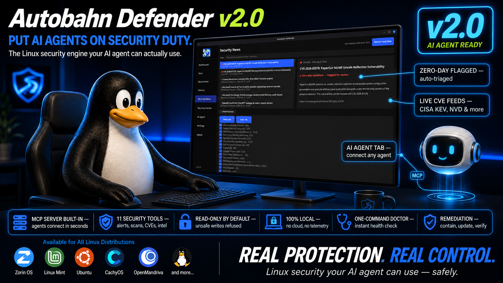

# Autobahn Defender v2.0 — Release Notes

**Put AI agents on security duty — safely.**

v2.0 turns Autobahn Defender from a GUI antivirus into a full security
platform: deterministic engine, headless CLI, CVE/zero-day intel, and a
built-in MCP server that lets AI agents (Hermes, Claude, OpenClaw…) run
security work under strict guardrails.

## Highlights
- 🤖 **MCP server** (11 tools) + AI Agent tab — read-only by default, token-gated writes
- 🖥️ **Full CLI** — every feature drivable headless, JSON + exit codes
- 🧠 **CVE & zero-day intel** — CISA KEV, Ubuntu USN, EPSS, PoC feeds; matched to installed packages; alerts auto-heal
- 🛡️ **Rebuilt YARA rules** — zero false positives on system files (was ~9,400 hits), and system files can never be auto-quarantined
- 🔐 **Honest remediation** — contain → update → verify (inconclusive ≠ fixed) → restore
- 🩺 `doctor` — 21-check environment self-check
- ✅ 123 tests, clean Ubuntu 24.04 VM verification

Full technical changelog: [CHANGELOG-v2.0.md](CHANGELOG-v2.0.md)

## Downloads
| File | For |
|------|-----|
| `autobahn-defender_2.0.0_amd64.deb` | Debian / Ubuntu / Linux Mint |
| `AutobahnDefender.AppImage` | Any distro (self-contained) |
| Source code | Arch & others (see README "Building from source") |

## Upgrade notes
- From 1.x or any interim 2.0 build: install normally, user data in
  `~/.autobahn` is preserved. The in-app updater handles the whole flow.
- After first launch, ClamAV definitions download once (or run `sudo freshclam`).
- AI setup: the README has a copy-paste prompt that makes your AI agent do
  the whole setup itself. 🙂